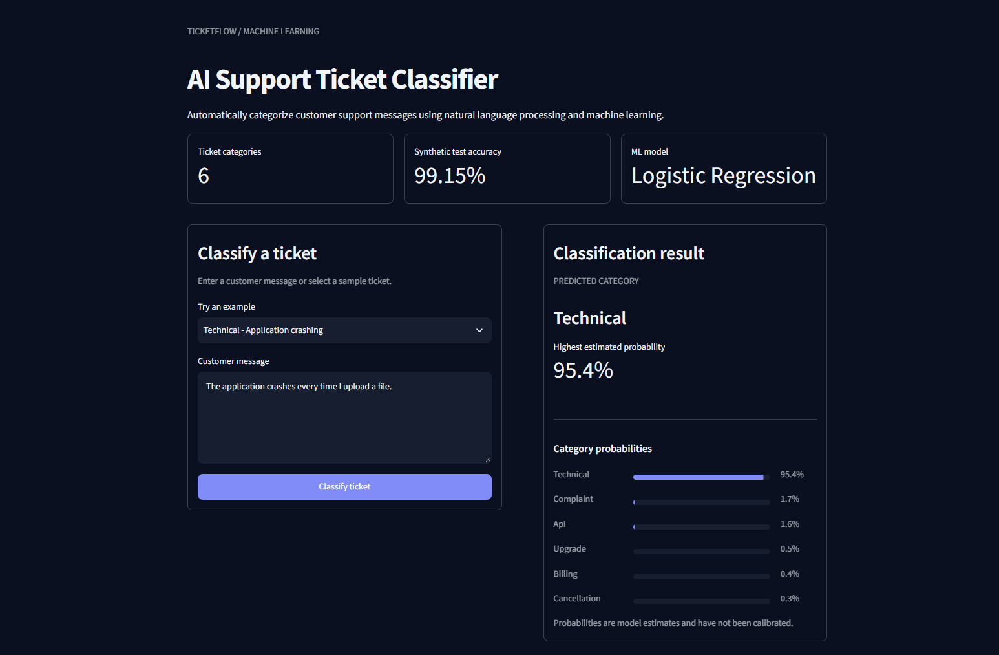

# AI Support Ticket Classifier

A machine learning application that automatically classifies
customer support messages into six categories.

## Live Demo

**[Try the AI Support Ticket Classifier](https://ticketflow-classifier.streamlit.app/)**

## Demo



## Features

- Classifies messages into **API, Billing, Cancellation, Complaint, Technical,** or **Upgrade**
- Displays model-estimated probabilities for all six categories
- Provides sample tickets for quick demonstrations
- Warns about very short messages and predictions without a clear leading category
- Uses a responsive two-column Streamlit dashboard with a custom dark theme
- Includes the trained model so the app runs **without retraining**

## Model Performance

| Metric | Result |
| --- | ---: |
| Training samples | 9,354 |
| Validation samples | 1,169 |
| Test samples | 1,170 |
| Validation accuracy | **98.89%** |
| Test accuracy | **99.15%** |

The model uses a scikit-learn `Pipeline` combining `TfidfVectorizer` with `LogisticRegression`. It was evaluated using accuracy, precision, recall, F1-score, and a confusion matrix.

**Important:** These scores come from a **synthetic** support-ticket dataset. Accuracy on real customer tickets may be lower. Displayed probabilities are model estimates and have **not** been calibrated.

## How It Works

1. A user enters a support message or selects an example.
2. TF-IDF converts the text into numeric features.
3. Logistic Regression predicts one of six categories.
4. The app displays the predicted category and estimated probabilities.

## Tech Stack

- **Python** for application and training code
- **pandas** for dataset exploration and evaluation
- **scikit-learn** for TF-IDF, Logistic Regression, and model evaluation
- **Streamlit** for the user interface
- **joblib** for saving and loading the trained pipeline

## Run Locally

The trained model is **already included** in `models/support_ticket_classifier.joblib`. You do **not** need to download the dataset or run training to use the app.

**Prerequisite:** Python 3.11 and Git.

### 1. Clone the repository

```bash
git clone https://github.com/Ong-CHW/ai-support-ticket-classifier.git
cd ai-support-ticket-classifier
```

### 2. Create a virtual environment

On Windows (PowerShell):

```powershell
py -3.11 -m venv .venv
```

On macOS/Linux:

```bash
python3.11 -m venv .venv
source .venv/bin/activate
```

### 3. Install dependencies

On Windows (PowerShell):

```powershell
.\.venv\Scripts\python.exe -m pip install -r requirements.txt
```

On macOS/Linux:

```bash
python -m pip install -r requirements.txt
```

### 4. Launch the application

On Windows (PowerShell):

```powershell
.\.venv\Scripts\python.exe -m streamlit run app.py
```

On macOS/Linux:

```bash
python -m streamlit run app.py
```

Open the local address shown in the terminal, typically `http://localhost:8501`.

## Optional: Retrain the Model

The project uses the [Support Ticket Router 12K Cleaned dataset](https://huggingface.co/datasets/cngchis/Support-Ticket-Router-12K-Cleaned), which contains labeled synthetic support messages.

To retrain the classifier:

1. Download `train.jsonl`, `val.jsonl`, and `test.jsonl` from the dataset's `processed` directory.
2. Create a `data/` folder and place the three files inside it.
3. Run the training script from the project root:

   **Windows:**
   ```powershell
   .\.venv\Scripts\python.exe train_model.py
   ```

   **macOS/Linux:**
   ```bash
   python train_model.py
   ```

The script trains the classifier, evaluates it, and overwrites the model file in `models/` with the newly trained pipeline. Dataset files are excluded from Git.

## Project Structure

```text
ai-support-ticket-classifier/
├── .streamlit/
│   └── config.toml
├── assets/
│   └── demo.png
├── models/
│   └── support_ticket_classifier.joblib  # Included in Git
├── app.py                                # Streamlit dashboard
├── train_model.py                        # Training and evaluation
├── explore.py                            # Dataset exploration
├── requirements.txt
├── .gitignore
└── README.md
```

The optional `data/` directory and local `.venv/` environment are excluded from Git.

## Limitations and Future Improvements

- The dataset is synthetic; performance on real-world messages needs further testing.
- The model predicts only one category, even if a ticket covers multiple issues.
- Estimated probabilities are not calibrated measures of certainty.
- Future improvements could include multi-label classification, probability calibration, and automatic ticket prioritization.
